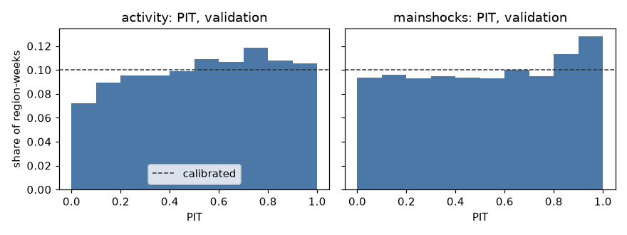

# Validation (train fit, validation weeks scored)

Pre-registration: `docs/experiments/anomaly-scan.md`.

## Calibration of the live tests

| test | alpha | region_weeks | rate_p_high_le_alpha | rate_p_low_le_alpha | rate_flag_excess | rate_flag_deficit | observed | expected | observed_over_expected | mean_log_score | pit_max_bin_deviation | calibrated |
|---|---|---|---|---|---|---|---|---|---|---|---|---|
| activity | 0.05 | 5287 | 0.0454 | 0.00738 | 0.00265 | 0 | 34350 | 3.24e+04 | 1.06 | -2.39 | 0.0281 | True |
| mainshocks | 0.05 | 5287 | 0.0426 | 0.00643 | 0.00322 | 0.000189 | 12903 | 1.19e+04 | 1.08 | -1.68 | 0.0282 | True |

## Model comparison

Mean log score per region-week; information gain vs. Poisson; 95% intervals
from a 13-week moving-block bootstrap.

| catalog | model | mean_log_score | mean_log_score_lo | mean_log_score_hi | info_gain | info_gain_lo | info_gain_hi | rate_p_high_le_alpha | rate_p_low_le_alpha |
|---|---|---|---|---|---|---|---|---|---|
| activity | poisson | -4.38 | -6.24 | -3.13 | 0 | 0 | 0 | 0.0789 | 0.0762 |
| activity | negative_binomial | -2.85 | -2.91 | -2.8 | 1.53 | 0.325 | 3.39 | 0.0223 | 0 |
| activity | empirical | -2.39 | -2.49 | -2.3 | 1.99 | 0.815 | 3.81 | 0.0454 | 0.00738 |
| mainshocks | poisson | -1.68 | -1.75 | -1.64 | 0 | 0 | 0 | 0.0426 | 0.00643 |
| mainshocks | negative_binomial | -1.69 | -1.72 | -1.66 | -0.000748 | -0.0173 | 0.0257 | 0.0286 | 0.00132 |
| mainshocks | empirical | -1.68 | -1.72 | -1.65 | 0.0019 | -0.0126 | 0.0259 | 0.0363 | 0.00246 |

## Detection power (injected extra events in one region-week)

Smallest burst flagged in at least 80% of validation weeks
(blank: never at the tested sizes):

| region | activity | mainshocks |
|---|---|---|
| alaska_aleutians | 80 | 10 |
| california_baja | 40 | 5 |
| cascadia | 20 | 5 |
| central_america | 40 | 10 |
| chile |  | 10 |
| indonesia |  | 20 |
| izu_bonin_marianas | 80 | 10 |
| japan |  | 10 |
| kamchatka_kurils | 160 | 10 |
| mexico | 80 | 10 |
| new_zealand | 80 | 5 |
| northern_andes | 20 | 10 |
| peru | 80 | 10 |
| png_solomons |  | 10 |
| taiwan_philippines | 80 | 10 |
| tonga_kermadec | 160 | 20 |
| vanuatu_fiji | 160 | 10 |
