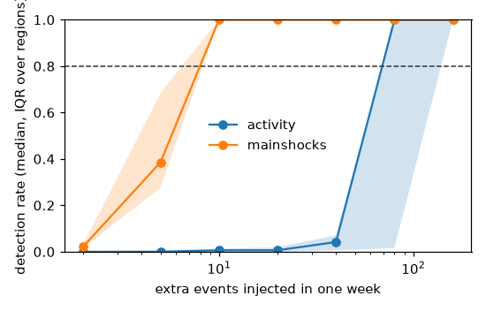

# Validation (train fit, validation weeks scored)

Pre-registration: `docs/experiments/anomaly-scan.md`.

## Calibration of the live tests

| test | alpha | region_weeks | rate_p_high_le_alpha | rate_p_low_le_alpha | rate_flag_excess | rate_flag_deficit | observed | expected | observed_over_expected | mean_log_score | pit_max_bin_deviation | calibrated |
|---|---|---|---|---|---|---|---|---|---|---|---|---|
| activity | 0.05 | 5287 | 0.0446 | 0.00643 | 0.00265 | 0 | 31739 | 2.99e+04 | 1.06 | -2.34 | 0.027 | True |
| mainshocks | 0.05 | 5287 | 0.0414 | 0.00511 | 0.00265 | 0.000189 | 11952 | 1.1e+04 | 1.08 | -1.64 | 0.0269 | True |

## Model comparison

Mean log score per region-week; information gain vs. Poisson; 95% intervals
from a 13-week moving-block bootstrap.

| catalog | model | mean_log_score | mean_log_score_lo | mean_log_score_hi | info_gain | info_gain_lo | info_gain_hi | rate_p_high_le_alpha | rate_p_low_le_alpha |
|---|---|---|---|---|---|---|---|---|---|
| activity | poisson | -4.4 | -6.4 | -3.11 | 0 | 0 | 0 | 0.0753 | 0.0741 |
| activity | negative_binomial | -2.81 | -2.87 | -2.76 | 1.59 | 0.343 | 3.55 | 0.0212 | 0 |
| activity | empirical | -2.34 | -2.43 | -2.25 | 2.07 | 0.842 | 4.01 | 0.0446 | 0.00643 |
| mainshocks | poisson | -1.64 | -1.7 | -1.59 | 0 | 0 | 0 | 0.0414 | 0.00511 |
| mainshocks | negative_binomial | -1.63 | -1.67 | -1.61 | 0.00153 | -0.016 | 0.032 | 0.0265 | 0.000757 |
| mainshocks | empirical | -1.63 | -1.67 | -1.6 | 0.00602 | -0.00981 | 0.0332 | 0.0378 | 0.000757 |

## Detection power (injected extra events in one region-week)

Smallest burst flagged in at least 80% of validation weeks
(blank: never at the tested sizes):

| region | activity | mainshocks |
|---|---|---|
| alaska_aleutians | 80 | 10 |
| california_baja | 40 | 5 |
| cascadia | 20 | 5 |
| central_america | 40 | 10 |
| chile |  | 10 |
| indonesia |  | 20 |
| izu_bonin_marianas | 80 | 10 |
| japan |  | 10 |
| kamchatka_kurils | 160 | 10 |
| mexico | 80 | 10 |
| new_zealand | 80 | 5 |
| northern_andes | 20 | 10 |
| peru | 80 | 10 |
| png_solomons |  | 10 |
| taiwan_philippines | 80 | 10 |
| tonga_kermadec | 160 | 20 |
| vanuatu_fiji | 160 | 10 |
